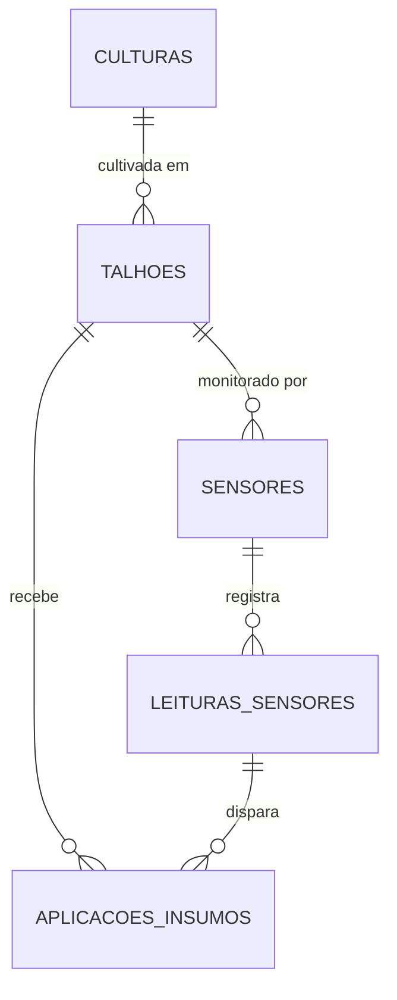
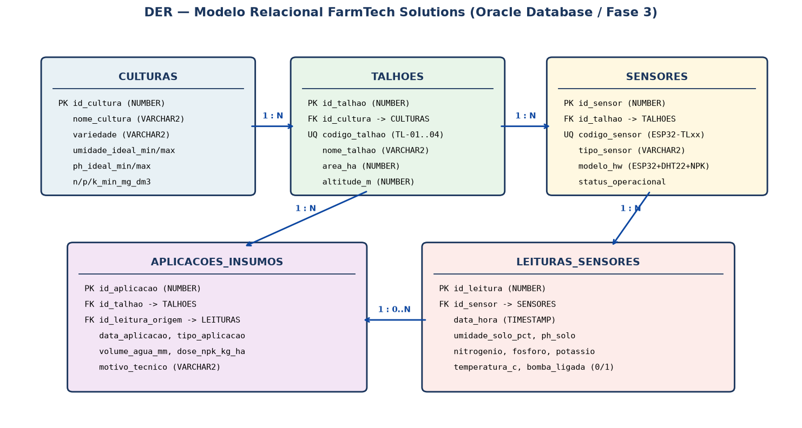
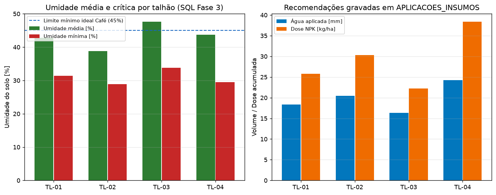

# FIAP - Faculdade de Informática e Administração Paulista

<p align="center">
  <a href="https://www.fiap.com.br/"></a>
</p>

<br>

# 📌 FarmTech Solutions — Fase 3: Colheita de Dados e Insights (Banco de Dados Oracle & CRUD de Sensores)

[](https://www.python.org/)
[](https://www.oracle.com/)
[](https://www.sqlite.org/)
[](LICENSE)

## 👨‍🎓 Integrantes
- [Jeliel Cardoso](https://www.linkedin.com/in/jelielcardoso/) — **RM572665**
- [Denis Paulo Dias da Silva](https://www.linkedin.com/in/denispaulodiassilva/) — **RM573278**
- [Deweyne Reuel](https://www.linkedin.com/in/deweyne-reuel-0695522a8/) — **RM573755**

## 👩‍🏫 Professores
### Tutor(a)
- [Sabrina Otoni](https://www.linkedin.com/in/sabrina-otoni-22525519b/)
### Coordenador(a)
- [André Godoi](https://www.linkedin.com/in/andregodoichiovato/)

---

## 📖 Descrição

Na **Fase 3 (Colheita de Dados e Insights)** do projeto **FarmTech Solutions**, estruturamos a persistência relacional em **Oracle Database** para receber as leituras coletadas pelos sensores IoT da Fase 2 (ESP32 + DHT22 + LDR + NPK) e registrar automaticamente as recomendações de manejo hídrico e nutricional por talhão.

O projeto entrega:
1. **Modelagem MER/DER completa** com 5 entidades (`CULTURAS`, `TALHOES`, `SENSORES`, `LEITURAS_SENSORES` e `APLICACOES_INSUMOS`) e script DDL oficial para Oracle (`sql/schema_oracle.sql`).
2. **Camada de persistência híbrida (`src/db.py`):** conecta ao Oracle via variáveis de ambiente (`.env`) e possui fallback transparente para SQLite, permitindo testar e demonstrar todas as consultas SQL localmente ou em integração com a Fase 7 sem depender de VPN/instância Oracle ativa.
3. **CRUD completo e motor de regras agronômicas (`src/crud_sensores.py`):** insere, consulta, atualiza e remove leituras de sensores, importa lotes JSON da Fase 2 e gera automaticamente registros em `APLICACOES_INSUMOS` sempre que a umidade ou os macronutrientes NPK ficam abaixo das faixas ideais da cultura.

---

## 🗂️ Modelagem MER / DER



<p align="center">
  
</p>

---

## 📊 Resultados e Relatório Analítico SQL

<p align="center">
  
</p>

---

## 📁 Estrutura de Pastas

```text
fase3-farmtech-banco-dados/
├── assets/
│   ├── logo-fiap.png
│   ├── der_farmtech.png
│   └── relatorio_sensores_fase3.png
├── data/
│   └── leituras_fase2_esp32.json
├── sql/
│   └── schema_oracle.sql
├── src/
│   ├── db.py
│   └── crud_sensores.py
├── tests/
│   └── test_fase3_db.py
├── main.py
├── .env.example
├── requirements.txt
├── LICENSE
└── README.md
```

---

## ⚙️ Como Executar

```bash
pip install -r requirements.txt
python main.py --demo
pytest -q
```

---

## 📄 Licença

Distribuído sob a licença [MIT](LICENSE).
