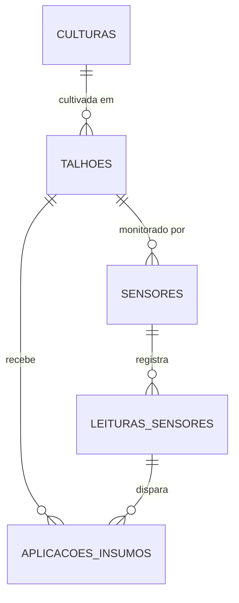
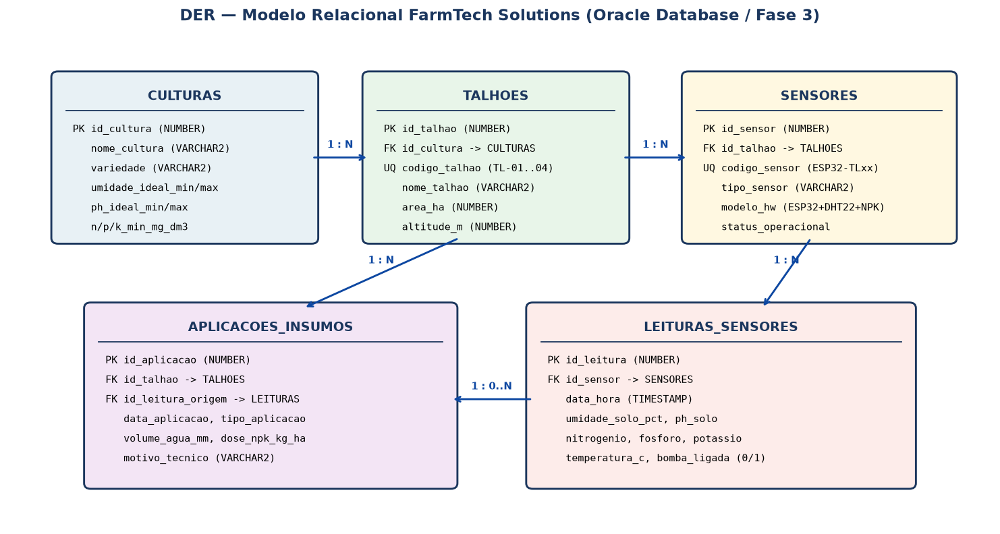
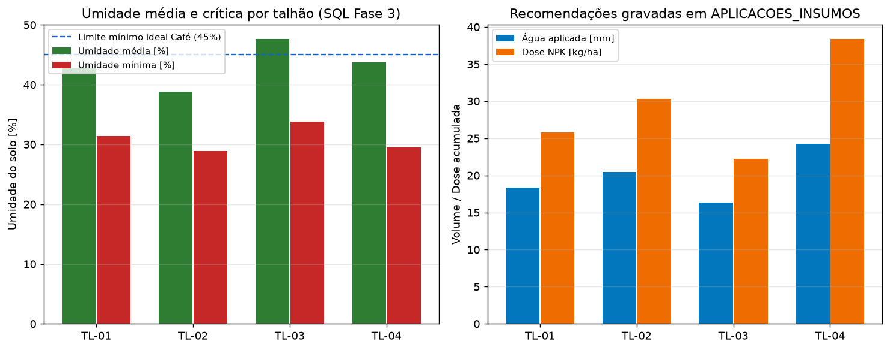

# FIAP - Faculdade de Informática e Administração Paulista

<p align="center">
  <a href="https://www.fiap.com.br/"></a>
</p>

<br>

# 📌 FarmTech Solutions — Fase 3: Colheita de Dados e Insights (Banco de Dados Oracle & CRUD de Sensores)

[](https://www.python.org/)
[](https://www.oracle.com/)
[](https://www.sqlite.org/)
[](LICENSE)
[](https://github.com/DenisPaulo/fase3-farmtech-banco-dados/actions/workflows/ci.yml)

## 👨‍🎓 Integrantes
- [Jeliel Cardoso](https://www.linkedin.com/in/jelielcardoso/) — **RM572665**
- [Denis Paulo Dias da Silva](https://www.linkedin.com/in/denispaulodiassilva/) — **RM573278**
- [Deweyne Reuel](https://www.linkedin.com/in/deweyne-reuel-0695522a8/) — **RM573755**

## 👩‍🏫 Professores
### Tutor(a)
- [Sabrina Otoni](https://www.linkedin.com/in/sabrina-otoni-22525519b/)
### Coordenador(a)
- [André Godoi](https://www.linkedin.com/in/andregodoichiovato/)

---

## 📖 Descrição

Na **Fase 3 (Colheita de Dados e Insights)** do projeto **FarmTech Solutions**, estruturamos a persistência relacional em **Oracle Database** para receber as leituras coletadas pelos sensores IoT da Fase 2 (ESP32 + DHT22 + LDR + NPK) e registrar automaticamente as recomendações de manejo hídrico e nutricional por talhão.

O projeto entrega:
1. **Modelagem MER/DER completa** com 5 entidades (`CULTURAS`, `TALHOES`, `SENSORES`, `LEITURAS_SENSORES` e `APLICACOES_INSUMOS`) e script DDL oficial para Oracle (`sql/schema_oracle.sql`).
2. **Camada de persistência (`src/db.py`):** lê as variáveis de `.env`. Com `FARMTECH_DB_ENGINE=oracle` e credenciais preenchidas, abre o Oracle. Com `FARMTECH_DB_ENGINE=sqlite` (modo da demonstração e do CI), abre um SQLite com as mesmas cinco tabelas. `python main.py --demo` e o `pytest` gravam e consultam nesse SQLite.
3. **CRUD completo e motor de regras agronômicas (`src/crud_sensores.py`):** insere, consulta, atualiza e remove leituras de sensores, importa lotes JSON da Fase 2 e gera automaticamente registros em `APLICACOES_INSUMOS` sempre que a umidade ou os macronutrientes NPK ficam abaixo das faixas ideais da cultura.
4. **PL/SQL (`sql/plsql_farmtech.sql`):** pacote `PKG_FARMTECH` com a procedure `PRC_INSERIR_LEITURA` (validação de faixa e tratamento de exceção), a função `FN_UMIDADE_MEDIA_TALHAO` (`AVG` da umidade por talhão) e o trigger `TRG_AUD_LEITURAS`, que registra cada `INSERT`, `UPDATE` e `DELETE` de `LEITURAS_SENSORES` na tabela `AUDITORIA_LEITURAS`.

---

## 🗂️ Modelagem MER / DER



<p align="center">
  
</p>

---

## 📊 Resultados e Relatório Analítico SQL

<p align="center">
  
</p>

---

## 📁 Estrutura de Pastas

```text
fase3-farmtech-banco-dados/
├── .github/
│   └── workflows/
│       └── ci.yml
├── assets/
│   ├── logo-fiap.png
│   ├── der_farmtech.png
│   └── relatorio_sensores_fase3.png
├── data/
│   └── leituras_fase2_esp32.json
├── sql/
│   ├── schema_oracle.sql
│   ├── plsql_farmtech.sql
│   ├── seed_exemplo.sql
│   └── aplicar_oracle.sql
├── src/
│   ├── db.py
│   └── crud_sensores.py
├── tests/
│   └── test_fase3_db.py
├── main.py
├── .env.example
├── requirements.txt
├── requirements-dev.txt
├── pyproject.toml
├── LICENSE
└── README.md
```

---

## ⚙️ Como executar no Windows

Pré-requisitos: [Git](https://git-scm.com/download/win) e [Python 3.12](https://www.python.org/downloads/windows/). No instalador do Python, marque **Add python.exe to PATH**.

No PowerShell:

```powershell
git clone https://github.com/DenisPaulo/fase3-farmtech-banco-dados.git
cd fase3-farmtech-banco-dados
py -3.12 -m venv .venv
Set-ExecutionPolicy -Scope Process -ExecutionPolicy Bypass
.\.venv\Scripts\Activate.ps1
python -m pip install --upgrade pip
pip install -r requirements.txt
pip install -r requirements-dev.txt
Copy-Item .env.example .env
python main.py --demo
pytest -q
```

`python main.py --demo` recria o SQLite em `data/farmtech_fase3.db`, importa `data/leituras_fase2_esp32.json`, executa o CRUD e grava os gráficos em `assets/`. `pytest -q` roda a suíte nesse mesmo modo. O lint local usa `ruff check .` (configuração em `pyproject.toml`).

O arquivo `.env` fica na máquina. Os placeholders de `.env.example` (`seu_usuario` / `sua_senha`) e `FARMTECH_DB_ENGINE=sqlite` mantêm a demonstração Python no SQLite.

### Linux e macOS

```bash
python3.12 -m venv .venv
source .venv/bin/activate
python -m pip install --upgrade pip
pip install -r requirements.txt
pip install -r requirements-dev.txt
cp .env.example .env
python main.py --demo
pytest -q
```

---

## Oracle: FIAP ou Oracle XE no Docker

O modelo relacional está em `sql/schema_oracle.sql`. O pacote, a função de agregação e o gatilho de auditoria estão em `sql/plsql_farmtech.sql`. Execute o DDL e, em seguida, o PL/SQL, com o usuário da aplicação.

| Objeto | Papel |
| --- | --- |
| `PKG_FARMTECH.PRC_INSERIR_LEITURA` | Insere uma leitura com validação de faixa, exceções de aplicação e o mesmo registro automático em `APLICACOES_INSUMOS` usado pelo CRUD Python |
| `PKG_FARMTECH.FN_UMIDADE_MEDIA_TALHAO` | Retorna `ROUND(AVG(umidade_solo_pct), 2)` do talhão |
| `TRG_AUD_LEITURAS` | Depois de `INSERT`, `UPDATE` ou `DELETE` em `LEITURAS_SENSORES`, grava a operação em `AUDITORIA_LEITURAS` |

Faixas aceitas pela procedure: código de sensor existente em `SENSORES` (fora do cadastro, erro `-20001`); umidade de 0 a 100 (`-20002`); pH de 0 a 14 (`-20003`); N, P e K a partir de zero (`-20004`); `bomba_ligada` nulo, 0 ou 1 (`-20005`); temperatura informada (`-20006`). A função devolve `-20010` quando o código de talhão fica fora de `TALHOES`.

### Instância da FIAP

Copie `.env.example` para `.env` e preencha o usuário do laboratório:

```text
FARMTECH_DB_ENGINE=sqlite
ORACLE_USER=seu_usuario
ORACLE_PASSWORD=sua_senha
ORACLE_HOST=oracle.fiap.com.br
ORACLE_PORT=1521
ORACLE_SERVICE=ORCL
```

No SQL Developer, conecte com essas variáveis. Abra `sql/schema_oracle.sql`, execute o script (F5) e repita com `sql/plsql_farmtech.sql`.

### Oracle XE no Docker Desktop (Windows)

Com o Docker Desktop em execução, a imagem [`gvenzl/oracle-xe`](https://hub.docker.com/r/gvenzl/oracle-xe) sobe a 21c XE com o serviço `XEPDB1`:

```powershell
docker run -d --name farmtech-oracle -p 1521:1521 `
  -e ORACLE_PASSWORD=sua_senha `
  -e APP_USER=seu_usuario `
  -e APP_USER_PASSWORD=sua_senha `
  gvenzl/oracle-xe:21-slim
```

A imagem [`gvenzl/oracle-free`](https://hub.docker.com/r/gvenzl/oracle-free) publica o serviço `FREEPDB1`:

```powershell
docker run -d --name farmtech-oracle-free -p 1521:1521 `
  -e ORACLE_PASSWORD=sua_senha `
  -e APP_USER=seu_usuario `
  -e APP_USER_PASSWORD=sua_senha `
  gvenzl/oracle-free:23-slim
```

Aguarde o banco ficar pronto. O log exibe `DATABASE IS READY TO USE` quando a instância aceita sessão. Envie a pasta `sql` e aplique o DDL, o PL/SQL e o seed pelo SQL*Plus do container. `NLS_LANG=.AL32UTF8` preserva os acentos do cadastro.

Oracle XE (`XEPDB1`):

```powershell
docker logs -f farmtech-oracle
docker cp sql farmtech-oracle:/tmp/farmtech-sql
docker exec -e NLS_LANG=.AL32UTF8 farmtech-oracle sqlplus -s seu_usuario/sua_senha@//localhost/XEPDB1 @/tmp/farmtech-sql/aplicar_oracle.sql
docker exec -e NLS_LANG=.AL32UTF8 farmtech-oracle sqlplus -s seu_usuario/sua_senha@//localhost/XEPDB1 @/tmp/farmtech-sql/seed_exemplo.sql
```

Oracle Free (`FREEPDB1`):

```powershell
docker logs -f farmtech-oracle-free
docker cp sql farmtech-oracle-free:/tmp/farmtech-sql
docker exec -e NLS_LANG=.AL32UTF8 farmtech-oracle-free sqlplus -s seu_usuario/sua_senha@//localhost/FREEPDB1 @/tmp/farmtech-sql/aplicar_oracle.sql
docker exec -e NLS_LANG=.AL32UTF8 farmtech-oracle-free sqlplus -s seu_usuario/sua_senha@//localhost/FREEPDB1 @/tmp/farmtech-sql/seed_exemplo.sql
```

Para apontar o `.env` ao container XE:

```text
FARMTECH_DB_ENGINE=sqlite
ORACLE_USER=seu_usuario
ORACLE_PASSWORD=sua_senha
ORACLE_HOST=localhost
ORACLE_PORT=1521
ORACLE_SERVICE=XEPDB1
```

`FARMTECH_DB_ENGINE=sqlite` mantém `python main.py --demo` e o `pytest` no arquivo local. O pacote PL/SQL roda na sessão Oracle (SQL*Plus do container ou SQL Developer).

### Chamadas de exemplo

`sql/seed_exemplo.sql` carrega as mesmas culturas, talhões e sensores do SQLite (`ESP32-TL01` a `ESP32-TL04`). Com esse cadastro aplicado:

```sql
VARIABLE v_id NUMBER
BEGIN
    PKG_FARMTECH.PRC_INSERIR_LEITURA(
        p_codigo_sensor     => 'ESP32-TL01',
        p_umidade_solo_pct  => 32.5,
        p_ph_solo           => 5.6,
        p_nitrogenio_mg_dm3 => 22,
        p_fosforo_mg_dm3    => 10,
        p_potassio_mg_dm3   => 80,
        p_temperatura_c     => 25.0,
        p_id_leitura        => :v_id
    );
END;
/
PRINT v_id

SELECT PKG_FARMTECH.FN_UMIDADE_MEDIA_TALHAO('TL-01') AS umidade_media_pct FROM DUAL;

SELECT id_auditoria, id_leitura, operacao, usuario_banco, data_evento, detalhe
  FROM AUDITORIA_LEITURAS
 ORDER BY id_auditoria;
```

---

## Integração contínua

O workflow [`.github/workflows/ci.yml`](.github/workflows/ci.yml) roda em `ubuntu-latest` e `windows-latest` com Python 3.12. Ele instala `requirements.txt` e `requirements-dev.txt` e executa `pytest -q` com `FARMTECH_DB_ENGINE=sqlite`.

A suíte cobre o CRUD no SQLite e o comando `python main.py --demo`. O pacote PL/SQL é executado na instância Oracle da FIAP ou no Oracle XE/Free do Docker Desktop. O CI publica o resultado do modo SQLite.

---

## 📄 Licença

Distribuído sob a licença [MIT](LICENSE).
